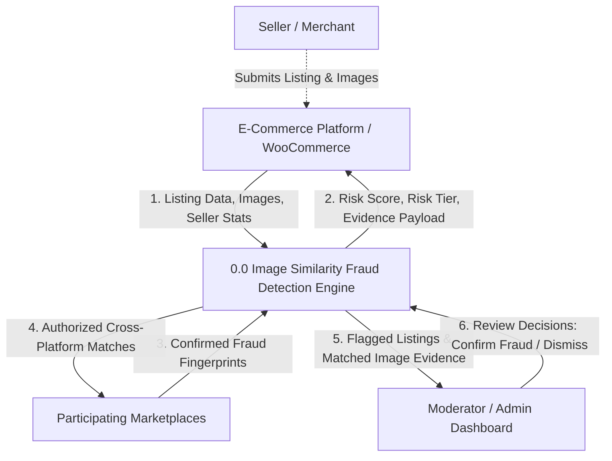
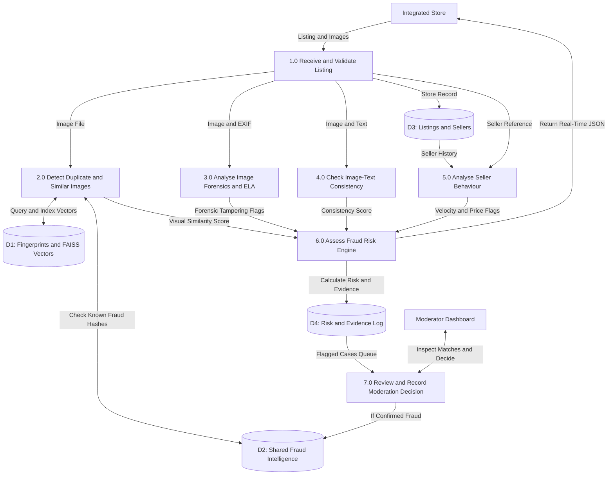
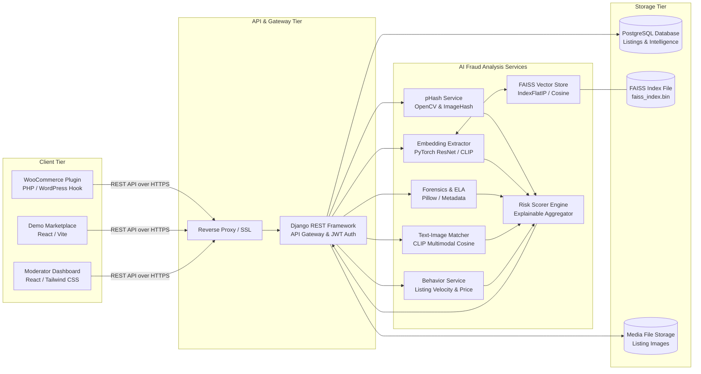
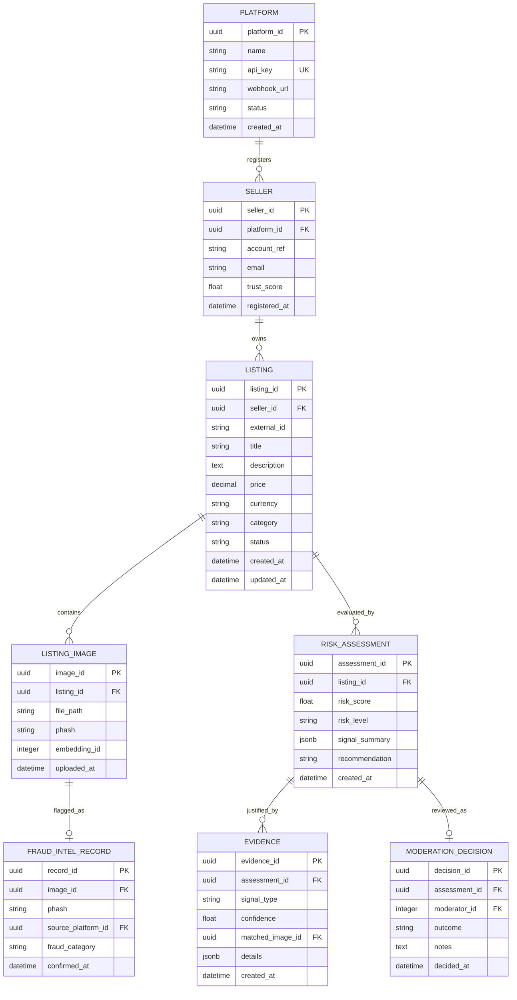

# Image Similarity

### AI-Powered Image Similarity and Cross-Platform Fraud Detection System for E-Commerce Security

**Author:** Emmanuel Kibet  
**Institution:** Mama Ngina University College | Department of Computer Science (SPAS / CIT)  
**Project Classification:** Bachelor of Science in Computer Science Final Project  
**Target Completion:** 10 Weeks (50 Working Days)

---

## 1. Executive Summary & Problem Formulation

### 1.1 The Challenge

In modern electronic commerce, visual representations are the primary driver of consumer purchasing decisions. However, fraudulent sellers exploit this reliance by:

1. **Stealing Product Photography:** Reusing high-quality images from legitimate manufacturers, brands, or competing sellers to advertise products they do not possess.
2. **Evading Simple Hashes via Transformations:** Altering images using cropping, aspect-ratio scaling, rotation, aggressive JPEG compression, color adjustment, and text/watermark injection to defeat conventional exact-matching mechanisms (such as MD5 or SHA-256).
3. **Cross-Platform Fraud Migration:** When a fraudulent listing is removed from one platform, the perpetrator relocates the exact same imagery and deceptive copy to another marketplace without friction, exploiting platform isolation.
4. **Deceptive Image-Description Inconsistencies:** Advertising high-value electronics (e.g., iPhone 15 Pro) while pairing them with misleading photos of counterfeit accessories or completely different devices.
5. **Reactive and Manual Moderation:** Marketplaces predominantly investigate fraud only after buyer disputes, financial chargebacks, or manual complaints, which are slow, labor-intensive, and unscalable.

### 1.2 The Proposed Solution

**Image Similarity** is an intelligent, multi-layered fraud detection and cross-platform intelligence service. Rather than relying on a single indicator or making black-box automated bans, the system evaluates listings through an **explainable multi-signal AI pipeline**:

- **Perceptual Hashing (pHash):** Ultra-fast duplicate and near-duplicate fingerprinting using 64-bit DCT-based Hamming distance comparison.
- **Deep Visual Feature Embeddings (ResNet & CLIP):** High-dimensional vector extraction invariant to severe transformations (crops, rotations, filters).
- **Vector Similarity Search (FAISS):** Sub-millisecond approximate nearest neighbor index over millions of product embeddings.
- **Digital Image Forensics:** EXIF metadata analysis and Error Level Analysis (ELA) for detecting resaved compression artifacts and digital tampering.
- **Multimodal Image-Text Consistency:** Cross-modal cosine similarity comparing product titles/descriptions against visual content using CLIP.
- **Seller Behavioral Analytics:** Real-time anomaly detection identifying burst listing velocity, cross-account image recycling, and abnormal price deviations against category medians.
- **Shared Cross-Platform Intelligence Repository:** Centralized fingerprint registry enabling participating platforms to detect previously confirmed fraudulent imagery without exposing sensitive customer PII.
- **Explainable Risk Assessment Engine:** Aggregates all signals into a composite score (0–100), risk tier (`LOW`, `MEDIUM`, `HIGH`), and structured evidence items to empower human moderators.

---

## 2. System Architecture & Engineering Models

### 2.1 Logical Architecture: Context Diagram (Level 0 DFD)



### 2.2 Level 1 Logical Data Flow Diagram (DFD)



### 2.3 Physical Architecture View



---

## 3. Database Schema & Entity Relationships

The data model directly reflects the research proposal's Entity-Relationship Diagram (Figure 4.7):



---

## 4. REST API Specification

### 4.1 Endpoint Overview

| Method | Endpoint                        | Access         | Purpose                                               |
| ------ | ------------------------------- | -------------- | ----------------------------------------------------- |
| `POST` | `/api/v1/platforms/register/`   | Admin          | Register marketplace and issue API Key                |
| `POST` | `/api/v1/listings/analyze/`     | Platform Key   | Real-time submission & fraud screening                |
| `GET`  | `/api/v1/listings/{id}/status/` | Platform / Mod | Retrieve assessment status & evidence                 |
| `GET`  | `/api/v1/moderation/queue/`     | Moderator JWT  | Fetch pending flagged listings sorted by risk         |
| `POST` | `/api/v1/moderation/decide/`    | Moderator JWT  | Record moderator verdict & update shared intel        |
| `GET`  | `/api/v1/intelligence/lookup/`  | Platform Key   | Query pHash in shared cross-platform fraud repository |
| `GET`  | `/api/v1/analytics/overview/`   | Moderator JWT  | System-wide statistics (counts, precision, latency)   |

### 4.2 Core Payload Contract: `POST /api/v1/listings/analyze/`

- **Request (`multipart/form-data`):**
  - `external_id`: `"wc_prod_5021"`
  - `seller_account_ref`: `"merchant_49"`
  - `title`: `"Sony WH-1000XM5 Wireless Noise-Cancelling Headphones"`
  - `description`: `"Brand new unopened original box with invoice..."`
  - `price`: `12500.00`
  - `currency`: `"KES"`
  - `category`: `"Audio & Electronics"`
  - `images`: `[image1.jpg, image2.jpg]`

- **Response (`200 OK` / `201 Created`):**

```json
{
  "listing_id": "8f3b1a20-41be-4d56-b08e-9c24efb14902",
  "external_id": "wc_prod_5021",
  "status": "FLAGGED",
  "assessment": {
    "assessment_id": "e3a479b1-50de-4411-9a7c-bc3e74811a43",
    "risk_score": 84.2,
    "risk_level": "HIGH",
    "recommendation": "MANUAL_REVIEW",
    "signal_summary": {
      "phash_duplicate_score": 0.0,
      "deep_vector_similarity": 0.92,
      "forensic_manipulation": 0.7,
      "text_consistency": 0.28,
      "seller_behavior_risk": 0.85
    },
    "evidence": [
      {
        "signal_type": "VECTOR_SIMILARITY",
        "confidence": 0.92,
        "matched_listing_id": "22bc9910-33de-4011-88fc-1209bcfa4410",
        "details": {
          "model": "ResNet50_FAISS",
          "cosine_similarity": 0.921,
          "source_platform": "Kilimani Electronics",
          "note": "Near-duplicate cropped image found on another platform."
        }
      },
      {
        "signal_type": "TEXT_MISMATCH",
        "confidence": 0.72,
        "details": {
          "clip_similarity": 0.28,
          "note": "Visual content does not match title and audio specs."
        }
      },
      {
        "signal_type": "PRICING_ANOMALY",
        "confidence": 0.85,
        "details": {
          "category_median": 42000.0,
          "offered_price": 12500.0,
          "deviation_percentage": -70.2,
          "note": "Price is 70% below category benchmark."
        }
      }
    ],
    "evaluated_at": "2026-11-19T10:00:00Z",
    "latency_ms": 385
  }
}
```

---

## 5. Repository & Directory Structure

```
c:\Users\ADMIN\Desktop\project/
│
├── README.md                          # Master documentation & 50-day engineering blueprint
│
├── backend/                           # Django REST API & AI Fraud Detection Engine
│   ├── manage.py
│   ├── requirements.txt
│   ├── config/                        # Django root settings, URLs, WSGI/ASGI
│   │   ├── __init__.py
│   │   ├── settings.py
│   │   ├── urls.py
│   │   └── wsgi.py
│   ├── apps/
│   │   ├── accounts/                  # Authentication, JWT, Moderator & Platform Admin roles
│   │   ├── marketplace/               # Platform, Seller, Listing, ListingImage models
│   │   ├── fraud_engine/              # AI Detection Pipeline & Services
│   │   │   ├── services/
│   │   │   │   ├── preprocessing.py   # Resizing, normalization, format checks
│   │   │   │   ├── phash_service.py   # pHash, dHash, Hamming distance
│   │   │   │   ├── embedding_service.py # PyTorch ResNet / CLIP vector extraction
│   │   │   │   ├── vector_store.py    # FAISS vector indexing & query
│   │   │   │   ├── forensics_service.py # EXIF metadata & Error Level Analysis (ELA)
│   │   │   │   ├── consistency_service.py # CLIP image-text semantic alignment
│   │   │   │   ├── behavior_service.py # Velocity, price anomaly & cross-account reuse
│   │   │   │   └── risk_aggregator.py # Explainable scoring & evidence builder
│   │   │   ├── api/                   # REST serializers, views, routes
│   │   │   └── models.py              # RiskAssessment, Evidence, ModerationDecision
│   │   └── intelligence/              # Shared cross-platform fraud repository
│   │       ├── models.py              # FraudIntelligenceRecord
│   │       └── api/                   # Intelligence lookup endpoints
│   └── tests/                         # Pytest unit & integration test suites
│
├── frontend/                          # React + Tailwind CSS Moderator Dashboard
│   ├── package.json
│   ├── vite.config.js
│   ├── src/
│   │   ├── api/                       # Axios client & endpoints
│   │   ├── components/                # UI components (EvidenceViewer, RiskBadge, Modal)
│   │   ├── pages/
│   │   │   ├── DashboardPage.jsx      # Overview stats & flagged cases queue
│   │   │   ├── ReviewCasePage.jsx     # Side-by-side visual image comparison
│   │   │   └── IntelligencePage.jsx   # Shared fraud hash lookup
│   │   └── routes/                    # Protected moderator routes
│
├── plugin/
│   └── woocommerce/                   # WordPress / WooCommerce Integration Plugin
│       ├── nexora-woocommerce.php     # Product hook listener & API dispatcher
│       └── readme.txt                 # Installation and configuration guide
│
├── demo-store/                        # Demonstration E-Commerce Store for Simulation
│   ├── src/                           # Product catalog & seller submission form
│   └── package.json
│
└── evaluation/                        # Benchmarks, Datasets & Metrics Scripts
    ├── datasets/                      # Legitimate, duplicated & modified image samples
    ├── perturbation_generator.py      # Crops, resizes, rotations, compression, noise
    └── benchmark_runner.py            # Precision, Recall, F1, ROC-AUC, Latency calculator
```

---

## 6. Detailed 50-Day Work Plan: From Start to Finish

The project is executed over **10 Weeks (50 Working Days)** following the **Iterative and Incremental Development Model** (Sommerville, 2016). Every single day has a clear objective, implementation tasks, concrete code deliverables, and measurable acceptance criteria.

---

### Phase 1: Inception, Environment & Domain Modeling (Week 1–2)

#### Week 1: Foundation, Environment Architecture & Base Domain

- **Day 1: Project Setup & Version Control Blueprint**
  - _Tasks:_ Initialize clean Git repository, setup branching model (`main`, `develop`, feature branches), define commit conventions.
  - _Deliverable:_ `.gitignore`, `.editorconfig`, project directory skeleton.
  - _Acceptance Criteria:_ Clean repo structure, zero stray files, git status clean.
- **Day 2: Backend Architecture & Virtual Environment Setup**
  - _Tasks:_ Configure Python 3.12 environment, structure `requirements.txt` into Core, AI, and Testing sections. Create base Django project configuration.
  - _Deliverable:_ `backend/manage.py`, `backend/config/settings.py` with environment variable loading.
  - _Acceptance Criteria:_ `python manage.py check` executes with zero errors.
- **Day 3: Authentication & Role-Based Access Control (RBAC)**
  - _Tasks:_ Implement `accounts` app. Configure JWT authentication with custom claims distinguishing `Moderator`, `Platform Admin`, and `Store Owner`.
  - _Deliverable:_ `accounts/models.py`, `accounts/views.py` (register, login, refresh, profile).
  - _Acceptance Criteria:_ Token authentication tested via automated curl/pytest; valid JWT returns user role.
- **Day 4: Marketplace Domain Models (Platform & Seller)**
  - _Tasks:_ Implement `Platform` model (with unique API keys and status) and `Seller` model (with account references and trust scores).
  - _Deliverable:_ `marketplace/models.py` (Platform, Seller), initial database migration.
  - _Acceptance Criteria:_ Migrations apply cleanly; platforms can be created with unique API keys.
- **Day 5: Listing & Image Storage Models**
  - _Tasks:_ Implement `Listing` (title, description, price, currency, category, status) and `ListingImage` (file path, pHash field, embedding_id) models.
  - _Deliverable:_ `marketplace/models.py` (Listing, ListingImage), migration scripts.
  - _Acceptance Criteria:_ Multi-image listings can be created and queried via Django ORM.

#### Week 2: Data Engineering, Perturbation Pipeline & Baseline Indexing

- **Day 6: Image Dataset Acquisition & Structuring**
  - _Tasks:_ Gather 500+ legitimate product images across electronics, apparel, and footwear from open-source datasets.
  - _Deliverable:_ `evaluation/datasets/raw/` organized by product category.
  - _Acceptance Criteria:_ Dataset verified, corrupt images stripped, minimum resolution $300\times300$.
- **Day 7: Image Perturbation Generator (Cropping & Resizing)**
  - _Tasks:_ Build automated script to generate modified copies using bounding-box cropping ($10\% - 40\%$) and aspect-ratio scaling.
  - _Deliverable:_ `evaluation/perturbation_generator.py` (crop and resize transforms).
  - _Acceptance Criteria:_ Script generates paired crops and maintains an evaluation mapping JSON.
- **Day 8: Image Perturbation Generator (Compression, Noise & Rotation)**
  - _Tasks:_ Extend perturbation script to apply JPEG compression ($Q=30, 50, 70$), slight rotations ($\pm 5^\circ, 15^\circ$), and Gaussian noise.
  - _Deliverable:_ Perturbation transforms for compression, rotation, and color jitter.
  - _Acceptance Criteria:_ 1,500+ synthetic test variants generated with transformation metadata.
- **Day 9: Synthetic Text & Seller Listing Data Generator**
  - _Tasks:_ Create script to simulate realistic e-commerce listings, pairing legitimate images with matching descriptions, and generating deceptive mismatched listings.
  - _Deliverable:_ `evaluation/synthetic_data_generator.py`.
  - _Acceptance Criteria:_ Labelled synthetic dataset containing 1,000 listings (70% legitimate, 30% fraudulent).
- **Day 10: Week 1–2 Review & Milestone Gate 1**
  - _Tasks:_ Run full test suite on database models, verify dataset integrity, document baseline statistics.
  - _Deliverable:_ Milestone 1 Report: Validated domain models, working test dataset.
  - _Acceptance Criteria:_ All Django tests pass; datasets ready for algorithmic development.

---

### Phase 2: Vision & Similarity Pipeline (Week 3–4: Iteration 1)

#### Week 3: Preprocessing & Perceptual Hashing (pHash)

- **Day 11: Image Preprocessing Service**
  - _Tasks:_ Implement `ImagePreprocessor` class to normalize dimensions ($224\times224$), convert color spaces (RGBA/Grayscale $\to$ RGB), and handle file streaming.
  - _Deliverable:_ `backend/apps/fraud_engine/services/preprocessing.py`.
  - _Acceptance Criteria:_ Processes multiple formats (JPEG, PNG, WebP) into standardized arrays.
- **Day 12: Discrete Cosine Transform Perceptual Hashing (pHash)**
  - _Tasks:_ Implement 64-bit DCT perceptual hash algorithm with fallback support for standard average hashing (aHash).
  - _Deliverable:_ `backend/apps/fraud_engine/services/phash_service.py`.
  - _Acceptance Criteria:_ Produces consistent 16-character hexadecimal hash for identical and near-identical images.
- **Day 13: Difference Hashing (dHash) & Hamming Distance Metrics**
  - _Tasks:_ Implement dHash (gradient-based hashing) and fast bitwise Hamming distance calculator: $\text{distance}(h_1, h_2) = \text{popcount}(h_1 \oplus h_2)$.
  - _Deliverable:_ `calculate_hamming_distance()` method and dual-hash fingerprinting.
  - _Acceptance Criteria:_ Identical images return distance $0$; minor crops return distance $\le 8$.
- **Day 14: Perceptual Hash Database Query & Indexing**
  - _Tasks:_ Implement lookup service to search stored listing image hashes for Hamming distance $\le \tau$ (where $\tau = 10$).
  - _Deliverable:_ Hash query service querying existing database images.
  - _Acceptance Criteria:_ Sub-10ms lookup over 5,000 stored hashes.
- **Day 15: Perceptual Hashing Unit Testing & Transformation Robustness**
  - _Tasks:_ Write automated tests measuring pHash survival against resizing, compression, and minor crops.
  - _Deliverable:_ `backend/tests/test_phash.py`.
  - _Acceptance Criteria:_ $\ge 95\%$ duplicate detection rate for compressed/resized variants; tests pass in CI.

#### Week 4: Deep Learning Embeddings & Vector Search (FAISS)

- **Day 16: Deep Feature Extractor Pipeline (ResNet/CLIP)**
  - _Tasks:_ Integrate pre-trained vision backbone (PyTorch ResNet-50 / CLIP visual model) to extract dense 512-dimensional normalized feature vectors.
  - _Deliverable:_ `backend/apps/fraud_engine/services/embedding_service.py`.
  - _Acceptance Criteria:_ Extracted vectors are unit-normalized ($\|v\|_2 = 1.0$).
- **Day 17: FAISS Vector Store Integration (IndexFlatIP)**
  - _Tasks:_ Implement FAISS vector store service utilizing Inner Product (`IndexFlatIP`) for ultra-fast cosine similarity computation.
  - _Deliverable:_ `backend/apps/fraud_engine/services/vector_store.py`.
  - _Acceptance Criteria:_ Sub-millisecond $k$-NN search over 10,000 vectors.
- **Day 18: Vector Persistence & Incremental Synchronization**
  - _Tasks:_ Implement index disk serialization (`faiss.write_index`) and incremental vector insertion synchronized with Django ORM `image_id` mapping.
  - _Deliverable:_ FAISS index loading, saving, and thread-safe dynamic vector insertion.
  - _Acceptance Criteria:_ Persisted vector index survives server restart without data loss.
- **Day 19: Deep Similarity vs. pHash Fusion for Modified Copies**
  - _Tasks:_ Build unified visual similarity matcher combining pHash (tier 1: fast exact match) with FAISS embedding cosine similarity (tier 2: complex crops/rotations).
  - _Deliverable:_ `find_visual_duplicates()` method returning matched image IDs and similarity scores.
  - _Acceptance Criteria:_ Detects cropped images where pHash failed, achieving $\ge 90\%$ recall on transformed test set.
- **Day 20: Week 3–4 Review & Milestone Gate 2**
  - _Tasks:_ Benchmark pHash + FAISS pipeline on 1,500 synthetic transformed images. Measure precision, recall, and query latency.
  - _Deliverable:_ Milestone 2 Benchmark Report: Visual similarity pipeline verified.
  - _Acceptance Criteria:_ Combined visual similarity latency $< 150\text{ms}$ per image; precision $\ge 92\%$.

---

### Phase 3: Multi-Modal Analysis & Fraud Intelligence (Week 5–6: Iteration 2)

#### Week 5: Digital Image Forensics & Image-Text Consistency

- **Day 21: EXIF Metadata & Integrity Analysis**
  - _Tasks:_ Implement forensic service parsing EXIF headers: check camera make/model, identify editing software signatures (Photoshop, Canva, GIMP), detect stripped metadata.
  - _Deliverable:_ `backend/apps/fraud_engine/services/forensics_service.py` (EXIF parser).
  - _Acceptance Criteria:_ Identifies software tags and flags completely sanitized metadata.
- **Day 22: Error Level Analysis (ELA) for JPEG Compression Artifacts**
  - _Tasks:_ Implement Error Level Analysis (ELA) by re-saving image at standard quality ($Q=90$), calculating pixel-difference matrix, and computing compression inconsistency ratios.
  - _Deliverable:_ `compute_ela_metrics()` within `forensics_service.py`.
  - _Acceptance Criteria:_ Generates ELA difference score highlighting digitally spliced regions.
- **Day 23: Multimodal Image-Text Feature Extraction (CLIP)**
  - _Tasks:_ Implement multimodal text-image alignment service utilizing CLIP tokenizer and text encoder.
  - _Deliverable:_ `backend/apps/fraud_engine/services/consistency_service.py`.
  - _Acceptance Criteria:_ Generates text embedding vectors aligned with the image feature space.
- **Day 24: Cross-Modal Semantic Consistency Scoring**
  - _Tasks:_ Compute cosine similarity between listing text (title + description) and image vector: $\text{sim}(I, T) = \frac{v_I \cdot v_T}{\|v_I\| \|v_T\|}$. Calibrate semantic thresholds for deceptive mismatches.
  - _Deliverable:_ `evaluate_text_image_consistency()` returning score (0.0 to 1.0) and mismatch warning.
  - _Acceptance Criteria:_ Correctly flags severe mismatches (e.g., photo of shoes with title "MacBook Pro M3").
- **Day 25: Forensics & Consistency Unit Testing**
  - _Tasks:_ Test ELA and CLIP consistency services across 200 legitimate and 100 deceptive listing pairs.
  - _Deliverable:_ `backend/tests/test_forensics_consistency.py`.
  - _Acceptance Criteria:_ Mismatch detector achieves $\ge 85\%$ accuracy on deliberate semantic discrepancies.

#### Week 6: Seller Behavior Analytics & Shared Fraud Intelligence

- **Day 26: Seller Listing Velocity & Burst Analyzer**
  - _Tasks:_ Implement behavioral analytics service tracking listing creation frequency per seller (1-hour and 24-hour windows).
  - _Deliverable:_ `backend/apps/fraud_engine/services/behavior_service.py` (velocity module).
  - _Acceptance Criteria:_ Flags suspicious burst behavior (e.g. $> 10$ high-value listings within 1 hour).
- **Day 27: Category Price Anomaly & Outlier Detector**
  - _Tasks:_ Calculate rolling category price distributions (mean, median, standard deviation). Compute $Z$-score for incoming listing prices.
  - _Deliverable:_ `detect_price_anomaly()` within `behavior_service.py`.
  - _Acceptance Criteria:_ Flags listings priced $> 65\%$ below category median.
- **Day 28: Cross-Account Image Recycling Detector**
  - _Tasks:_ Check if an uploaded image hash was previously associated with a different seller account or platform.
  - _Deliverable:_ Cross-seller image collision detection query.
  - _Acceptance Criteria:_ Detects image reuse across distinct seller accounts in $< 15\text{ms}$.
- **Day 29: Shared Fraud Intelligence Repository**
  - _Tasks:_ Implement `intelligence` app and `FraudIntelligenceRecord` model. Create fast lookup for confirmed fraudulent hashes.
  - _Deliverable:_ `backend/apps/intelligence/models.py`, `backend/apps/intelligence/services.py`.
  - _Acceptance Criteria:_ Allows participating platforms to check if an image hash has been blacklisted as confirmed fraud.
- **Day 30: Week 5–6 Review & Milestone Gate 3**
  - _Tasks:_ Validate forensics, text consistency, seller behavior, and shared intelligence modules.
  - _Deliverable:_ Milestone 3 Report: All individual fraud signals fully operational.
  - _Acceptance Criteria:_ All four analytical engines produce calibrated scores between 0.0 and 1.0.

---

### Phase 4: Risk Engine, REST API & Interfaces (Week 7–8: Iteration 3 & 4)

#### Week 7: Explainable Risk Engine & REST API Endpoints

- **Day 31: Multi-Signal Risk Aggregation Formula**
  - _Tasks:_ Implement `RiskAggregator` combining visual similarity ($w_1=0.35$), shared fraud blacklist ($w_2=0.25$), seller behavior ($w_3=0.15$), text-image consistency ($w_4=0.15$), and forensics ($w_5=0.10$).
  - _Deliverable:_ `backend/apps/fraud_engine/services/risk_aggregator.py`.
  - _Acceptance Criteria:_ Generates calibrated risk score ($0.0 - 100.0$) and categorizes into `LOW` ($<35$), `MEDIUM` ($35-70$), and `HIGH` ($>70$).
- **Day 32: Structured Explainable Evidence Generation**
  - _Tasks:_ Implement evidence generator creating human-readable diagnostic records for every flag (matched image links, similarity percentages, ELA ratios, price deviation stats).
  - _Deliverable:_ Evidence building methods writing to `Evidence` model.
  - _Acceptance Criteria:_ Every flagged assessment includes at least one structured evidence item explaining why it was flagged.
- **Day 33: Core Real-Time Screening API (`/api/v1/listings/analyze/`)**
  - _Tasks:_ Implement DRF endpoint accepting `multipart/form-data` listing payloads, orchestrating the AI pipeline, and returning real-time risk assessment JSON.
  - _Deliverable:_ `backend/apps/fraud_engine/api/views.py` and `serializers.py`.
  - _Acceptance Criteria:_ End-to-end request executes within $< 500\text{ms}$ returning full JSON risk payload.
- **Day 34: Moderation Queue & Decision API Endpoints**
  - _Tasks:_ Implement `/api/v1/moderation/queue/` (sorted by risk score) and `POST /api/v1/moderation/decide/` (records verdict: `CONFIRMED_FRAUD`, `DISMISSED_LEGITIMATE`, `ESCALATED`).
  - _Deliverable:_ Moderation API views and URL routing.
  - _Acceptance Criteria:_ When fraud is confirmed, image pHash is automatically added to the Shared Fraud Intelligence repository.
- **Day 35: API Security, Key Verification & Rate Limiting**
  - _Tasks:_ Implement `PlatformKeyAuthentication` middleware, request throttling, and input validation schemas.
  - _Deliverable:_ Security middleware and API permission classes.
  - _Acceptance Criteria:_ Unauthorized requests return `401 Unauthorized`; malformed images return `400 Bad Request`.

#### Week 8: WooCommerce Plugin & React Moderator Dashboard

- **Day 36: WooCommerce Plugin Skeleton & Settings Page**
  - _Tasks:_ Create WordPress plugin `nexora-woocommerce.php`. Build admin settings page for entering Nexora API URL and Platform API Key.
  - _Deliverable:_ `plugin/woocommerce/nexora-woocommerce.php` (admin configuration).
  - _Acceptance Criteria:_ Plugin activates cleanly in WordPress without errors; settings save to `wp_options`.
- **Day 37: WooCommerce Listing Event Hook Integration**
  - _Tasks:_ Hook into `woocommerce_new_product` and `woocommerce_update_product`. Serialize product title, price, description, and images; dispatch asynchronous `wp_remote_post` to Nexora API.
  - _Deliverable:_ WooCommerce action hook dispatcher.
  - _Acceptance Criteria:_ Saving a product in WooCommerce triggers API call and logs the returned risk score.
- **Day 38: WooCommerce Admin Fraud Badges & Meta-Box**
  - _Tasks:_ Render risk status badge (`Low Risk`, `Flagged for Review`) in WooCommerce product list table and display evidence meta-box on product edit screen.
  - _Deliverable:_ WooCommerce admin UI hooks and badge renderer.
  - _Acceptance Criteria:_ Store manager sees visual fraud indicator directly inside WooCommerce admin.
- **Day 39: React Moderator Dashboard (Queue & Metrics View)**
  - _Tasks:_ Build React dashboard showing flagged listings table, risk score distribution, filterable by platform, risk level, and date.
  - _Deliverable:_ `frontend/src/pages/DashboardPage.jsx`, metric summary cards.
  - _Acceptance Criteria:_ Dashboard loads pending flagged listings dynamically from backend API.
- **Day 40: React Side-by-Side Visual Evidence Inspector**
  - _Tasks:_ Implement interactive modal/page showing uploaded listing image side-by-side with matched duplicate image, highlighting similarity %, forensic flags, and action buttons (`Confirm Fraud`, `Dismiss`).
  - _Deliverable:_ `frontend/src/pages/ReviewCasePage.jsx` and `EvidenceViewer.jsx`.
  - _Acceptance Criteria:_ Moderator can inspect visual comparison, submit decision, and see item removed from active queue.

---

### Phase 5: Demo Store, Testing, Benchmarks & Evaluation (Week 9–10)

#### Week 9: Demonstration Marketplace & End-to-End System Integration

- **Day 41: Demonstration Marketplace Store Setup**
  - _Tasks:_ Build lightweight client store (`demo-store`) allowing simulated users to browse products and merchants to upload new listings with images.
  - _Deliverable:_ `demo-store/` web interface.
  - _Acceptance Criteria:_ Operates as an independent participating platform connected via API keys.
- **Day 42: End-to-End Listing Screening Simulation**
  - _Tasks:_ Test end-to-end flow: create legitimate listing $\to$ low risk score $\to$ published. Upload stolen/modified image $\to$ flagged $\to$ held for review.
  - _Deliverable:_ Integration test suite validating complete client $\to$ API $\to$ AI $\to$ Dashboard loop.
  - _Acceptance Criteria:_ System correctly distinguishes between unique and stolen images in live flow.
- **Day 43: Cross-Platform Fraud Migration Scenario Test**
  - _Tasks:_ Simulate attacker listing stolen item on Store A $\to$ moderator confirms fraud $\to$ attacker attempts listing same item on Store B $\to$ Store B immediately flags it via Shared Intelligence.
  - _Deliverable:_ Cross-platform verification test script.
  - _Acceptance Criteria:_ Shared intelligence repository blocks/flags migrated image on Store B instantly.
- **Day 44: System Load & Concurrency Testing (Locust)**
  - _Tasks:_ Run stress test simulating 20 concurrent platform listing submissions. Measure throughput (RPS), memory usage, and response times.
  - _Deliverable:_ Load test configuration and latency distribution log.
  - _Acceptance Criteria:_ 95th-percentile response time $\le 1,200\text{ms}$; zero 500-series server errors.
- **Day 45: Week 9 Review & Bug Remediation**
  - _Tasks:_ Address edge cases identified during integration (e.g. handling corrupt image streams, non-English descriptions, extreme pricing zeros).
  - _Deliverable:_ Stability patch and bug fixes across backend and frontend.
  - _Acceptance Criteria:_ All end-to-end integration scenarios execute reliably.

#### Week 10: Quantitative Evaluation, Metrics Report & Project Finalization

- **Day 46: Benchmark Evaluation Suite Execution**
  - _Tasks:_ Run automated evaluation on labelled benchmark dataset (1,000 listings: legitimate, exact duplicates, crops, rotations, compression, text mismatches).
  - _Deliverable:_ `evaluation/benchmark_runner.py` execution and raw metrics log.
  - _Acceptance Criteria:_ Evaluation runs across all test splits without interruption.
- **Day 47: Metric Calculation (Precision, Recall, F1, ROC-AUC)**
  - _Tasks:_ Calculate confusion matrix, True Positives, False Positives, True Negatives, False Negatives. Plot ROC curve and calculate AUC.
  - _Deliverable:_ Evaluation script calculating:
    $$\text{Precision} = \frac{TP}{TP + FP}, \quad \text{Recall} = \frac{TP}{TP + FN}, \quad F_1 = 2 \cdot \frac{\text{Precision} \cdot \text{Recall}}{\text{Precision} + \text{Recall}}$$
  - _Acceptance Criteria:_ Generates publication-ready metrics tables and charts.
- **Day 48: Transformation Robustness Breakdown Analysis**
  - _Tasks:_ Tabulate detection recall for each transformation category independently (Cropping, Resizing, Rotation, Compression, Text Injection).
  - _Deliverable:_ Transformation resilience breakdown table.
  - _Acceptance Criteria:_ Identifies specific transformation thresholds where pHash degrades and deep embeddings maintain recall.
- **Day 49: Final Project Documentation & Academic Alignment**
  - _Tasks:_ Compile evaluation findings, screenshots of moderator dashboard, API latency benchmarks, and architectural conclusions into final project report.
  - _Deliverable:_ Complete project documentation and demonstration package.
  - _Acceptance Criteria:_ All requirements from Chapter 1 to 4 of proposal are demonstrably satisfied.
- **Day 50: Final Presentation & Demonstration Rehearsal**
  - _Tasks:_ Conduct full dry run of live demonstration: WooCommerce upload, instant fraud scoring, moderator evidence inspection, and cross-platform intelligence sharing.
  - _Deliverable:_ Final project sign-off, live demo recording/slides.
  - _Acceptance Criteria:_ Seamless, robust demonstration of the complete AI-powered e-commerce security system.

---

## 7. Performance & Success Evaluation Metrics

| Metric                                        | Target Goal        | Method of Measurement                                              |
| --------------------------------------------- | ------------------ | ------------------------------------------------------------------ |
| **Exact Duplicate Precision**                 | $\ge 99\%$         | pHash Hamming distance $\le 5$ on uncompressed copies              |
| **Near-Duplicate Recall (Transformed)**       | $\ge 88\%$         | Combined pHash + FAISS embeddings on crops, rotations, compression |
| **Image-Text Mismatch Detection F1**          | $\ge 82\%$         | CLIP cosine similarity against synthetic deceptive listings        |
| **Overall Fraud Risk Classification ROC-AUC** | $\ge 0.90$         | Scikit-learn ROC curve on 1,000 labelled validation listings       |
| **False Positive Rate (FPR)**                 | $\le 5.0\%$        | Legitimate seller listings erroneously flagged as high risk        |
| **Average API Response Time (P50)**           | $< 500\text{ms}$   | Measured over 500 consecutive listing submissions                  |
| **95th-Percentile API Latency (P95)**         | $< 1,200\text{ms}$ | Measured under 10 concurrent requests                              |

---

## 8. Development Rules & Engineering Standards

1. **Clean Code & Modularity:** Each analysis module (`phash`, `embeddings`, `forensics`, `consistency`, `behavior`) must remain strictly decoupled, accepting standardized image/text inputs and returning normalized confidence scores ($0.0 - 1.0$) with explanatory metadata.
2. **Explainability Over Black Boxes:** No automated seller bans are permitted. The system serves as a decision-support platform for human moderators, requiring clear evidence trails for every flag.
3. **Graceful Fallbacks:** If optional heavy neural backbones (e.g. PyTorch/FAISS) are not present or initializing, services must fall back to mathematical/statistical algorithms without crashing the host application.
4. **Data Privacy by Design:** In accordance with the Kenya Data Protection Act 2019, the Shared Fraud Intelligence repository stores only mathematical image hashes, listing references, and confirmation dates—never sensitive personal identity or customer data.
# Image-Similarity
