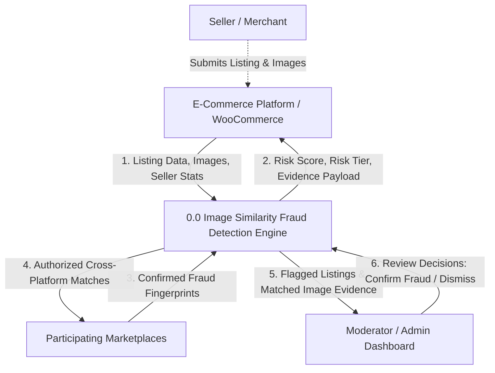

# Image Similarity
### AI-Powered Image Similarity and Cross-Platform Fraud Detection System for E-Commerce Security

[](https://www.python.org/)
[](https://docs.djangoproject.com/)
[](https://react.dev/)
[](https://pytorch.org/)
[](https://faiss.ai/)

**Author:** Emmanuel Kibet   
**Institution:** Mama Ngina University College | Department of Computer Science (SPAS / CIT)  
**Project Classification:** Bachelor of Science in Computer Science Final Project  
**Target Completion:** 10 Weeks (50 Working Days)

---

## 1. Project Overview

In online electronic commerce, visual product representations are the single largest factor influencing customer purchasing decisions. However, digital marketplaces face rampant listing fraud involving stolen photography, near-duplicate modified images (cropped, resized, compressed, or filtered to defeat traditional exact-match hashes), deceptive image-description mismatches, and fraudulent sellers hopping across platforms to evade enforcement.

**Image Similarity** is an intelligent, multi-layered fraud detection and cross-platform intelligence service. Rather than relying on a single indicator or making black-box automated bans, the system evaluates listings through an **explainable multi-signal AI pipeline**:

* **Perceptual Hashing (pHash & dHash):** Sub-10ms fingerprinting for exact and near-duplicate images.
* **Deep Feature Embeddings (ResNet & CLIP):** High-dimensional vector representations invariant to severe cropping, rotation, and color transformations.
* **Vector Similarity Search (FAISS):** Sub-millisecond approximate nearest-neighbor search over high-dimensional image indices.
* **Digital Image Forensics:** EXIF metadata analysis and Error Level Analysis (ELA) for detecting resaved compression artifacts and digital tampering.
* **Multimodal Image-Text Consistency:** Cross-modal semantic alignment comparing listing titles/descriptions against visual imagery using CLIP.
* **Seller Behavioral Analytics:** Real-time anomaly detection identifying burst listing velocity, price anomalies against category benchmarks, and cross-account image reuse.
* **Shared Cross-Platform Intelligence Repository:** Centralized fingerprint registry enabling participating platforms to detect previously confirmed fraudulent imagery without exposing customer PII.
* **Explainable Risk Assessment Engine:** Aggregates all signals into a composite score ($0.0 - 100.0$), a risk tier (`LOW`, `MEDIUM`, `HIGH`), and structured diagnostic evidence items to empower human moderators.

---

## 2. Documentation Directory (`docs/`)

All exhaustive technical specifications, architectural diagrams, mathematical formulations, and daily implementation plans are organized within the [`docs/`](docs/) directory:

| Document | Purpose & Contents | Link |
|---|---|---|
| **System Architecture** | Physical tier breakdown, component architecture, technology stack selection rationale, and security design. | [📄 `docs/architecture.md`](docs/architecture.md) |
| **Data Flow Diagrams (DFD)** | Context Diagram (Level 0 DFD), Level 1 Logical DFD, 7 core process mini-specs, and data stores catalog. | [📄 `docs/dataflow-diagrams.md`](docs/dataflow-diagrams.md) |
| **Project Plan & Roadmap** | Complete 10-Week / 50-Day engineering plan with concrete daily tasks, deliverables, and acceptance criteria. | [📄 `docs/project-plan.md`](docs/project-plan.md) |
| **Database Schema & ERD** | Entity-Relationship Diagram (ERD), full data dictionary, field definitions, types, indexes, and constraints. | [📄 `docs/database-schema.md`](docs/database-schema.md) |
| **REST API Specification** | OpenAPI-style contract for listing analysis, the moderator review queue, decision auditing, and shared intelligence. | [📄 `docs/api-specification.md`](docs/api-specification.md) |
| **Evaluation & Metrics** | Target performance metrics (Precision, Recall, ROC-AUC, Latency), math formulations, and perturbation test matrix. | [📄 `docs/evaluation-metrics.md`](docs/evaluation-metrics.md) |

---

## 3. System Architecture & Data Flow Summary

### 3.1 Logical Flow Preview (Context Diagram)

*For the complete Level 1 DFD and detailed process specifications, see [Data Flow Diagrams](docs/dataflow-diagrams.md).*

### 3.2 Physical Architecture Summary
The system consists of four decoupled tiers:
1. **Client Tier:** A lightweight WooCommerce plugin (PHP), a demonstration marketplace (React), and an administrative Moderator Dashboard (React + Tailwind CSS).
2. **API & Gateway Tier:** NGINX reverse proxy with a Django REST Framework gateway enforcing JWT and API key authentication.
3. **AI Analysis Pipeline:** Decoupled Python services running pHash, PyTorch ResNet/CLIP, FAISS vector indexing, ELA forensics, and an explainable risk scoring engine.
4. **Data Tier:** PostgreSQL database for relational records and serialized FAISS indices (`faiss_index.bin`) for high-speed vector retrieval.

*For detailed architectural component breakdowns, see [System Architecture](docs/architecture.md).*

---

## 4. Repository & Directory Organization

```
Image-Similarity/
│
├── README.md                          # Executive project summary & documentation index
│
├── docs/                              # System documentation & technical specifications
│   ├── architecture.md                # Component architecture, physical view & technology stack
│   ├── dataflow-diagrams.md           # Context Diagram (Level 0 DFD), Level 1 DFD & process specs
│   ├── project-plan.md                # 50-day / 10-week detailed implementation roadmap
│   ├── database-schema.md             # ERD, table definitions, constraints & data dictionary
│   ├── api-specification.md           # REST API endpoints, schemas & request/response payloads
│   └── evaluation-metrics.md          # Evaluation methodology, formulas & perturbation matrix
│
├── backend/                           # Django REST API & AI Fraud Detection Engine
│   └── .gitkeep
│
├── frontend/                          # React + Tailwind CSS Moderator Dashboard
│   └── .gitkeep
│
├── plugin/                            # E-Commerce Integration Plugins
│   └── woocommerce/                   # WordPress / WooCommerce integration plugin
│       └── .gitkeep
│
├── demo-store/                        # Demonstration E-Commerce Store for Simulation
│   └── .gitkeep
│
└── evaluation/                        # Benchmarks, Datasets & Metrics Scripts
    ├── datasets/                      # Raw & perturbed test image datasets
    │   └── .gitkeep
    └── benchmarks/                    # Benchmark execution & evaluation scripts
        └── .gitkeep
```

---

## 5. Target Performance Goals

* **Exact Duplicate Precision:** $\ge 99.0\%$ (pHash Hamming distance $\le 5$)
* **Near-Duplicate Recall (Transformed Copies):** $\ge 88.0\%$ (pHash + FAISS embeddings on crops, rotations, compression)
* **Image-Text Consistency F1-Score:** $\ge 82.0\%$ (CLIP cross-modal cosine similarity)
* **Overall Classification ROC-AUC:** $\ge 0.90$ (1,000 labelled validation listings)
* **False Positive Rate (FPR):** $\le 5.0\%$
* **Average API Response Time (P50):** $< 500\text{ms}$

*For complete evaluation formulas and protocols, see [Evaluation & Performance Metrics](docs/evaluation-metrics.md).*
