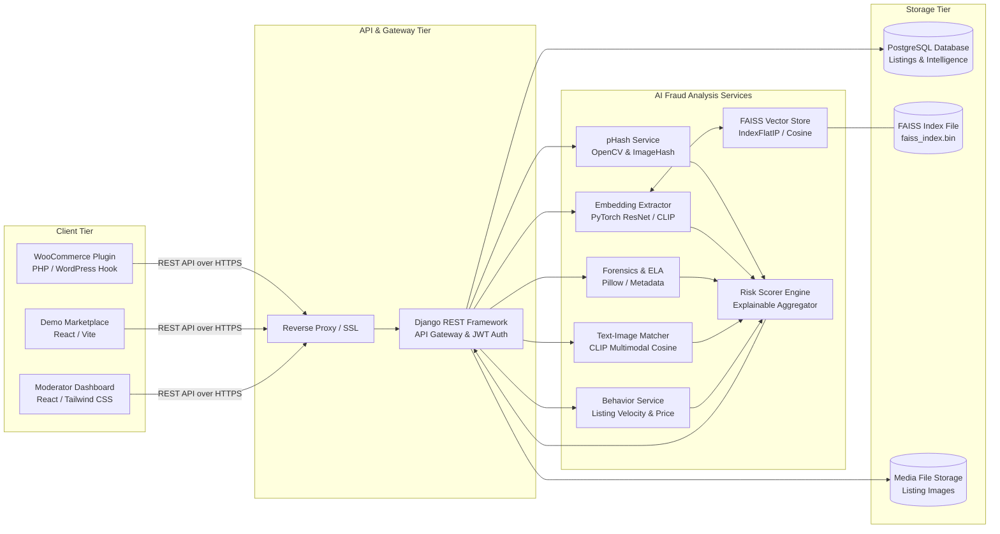

# System Architecture & Technical Specification

## 1. System Vision & Architecture Overview
**Image Similarity** is an AI-powered image similarity and cross-platform fraud detection system designed for modern e-commerce security. It prevents visual listing fraud—including stolen product photos, near-duplicate modified images (cropped, scaled, compressed, watermarked), deceptive image-description mismatches, and suspicious seller behavior—across participating marketplaces.

The system adopts a **Modular Layered Architecture** with decoupled services to ensure high availability, horizontal scalability, maintainability, and explainability.

---

## 2. Physical Architecture View

---

## 3. Component Breakdown

### 3.1 Client Integration Tier
* **WooCommerce Plugin (PHP):** Plugs into WordPress product lifecycle events (`woocommerce_new_product`, `woocommerce_update_product`), transmitting image streams and listing metadata asynchronously to the API. Displays visual fraud badges and evidence meta-boxes directly within the store manager's admin dashboard.
* **Demonstration Marketplace (React):** A headless simulated e-commerce platform allowing controlled testing of legitimate listing creation vs. fraudulent submissions.
* **Moderator Review Dashboard (React + Tailwind CSS):** A dedicated console for trust & safety teams. Provides an inbox of flagged listings sorted by risk score, featuring a side-by-side Visual Evidence Inspector (original image vs. matched stolen copy) and one-click verdict actions.

### 3.2 API & Gateway Tier
* **Reverse Proxy (NGINX):** Terminates TLS/HTTPS, manages CORS headers, and buffers large multi-part image uploads.
* **Django REST Framework (DRF):** Handles endpoint routing, request validation, serialization, rate limiting, and role-based access control (RBAC) using JSON Web Tokens (JWT) for moderators and API keys for client platforms.

### 3.3 Multi-Signal AI Analysis Pipeline
1. **Preprocessing Service:** Standardizes image dimensions ($224 \times 224$), normalizes color spaces (RGBA/Grayscale $\to$ RGB), and strips harmful payloads.
2. **Perceptual Hashing Service (pHash & dHash):** Computes compact 64-bit DCT-based visual fingerprints. Calculates bitwise Hamming distance to detect identical and lightly compressed/resized duplicates in $< 10\text{ms}$.
3. **Deep Feature Embedding Service (PyTorch ResNet / CLIP):** Extracts dense, unit-normalized 512-dimensional semantic vectors that capture high-level object features invariant to aggressive crops, rotations, color shifts, and background editing.
4. **Vector Search Engine (FAISS):** Employs Facebook AI Similarity Search (`IndexFlatIP`) to perform sub-millisecond approximate nearest neighbor searches over millions of listing embeddings using cosine similarity.
5. **Digital Image Forensics Service:** Extracts and parses EXIF metadata (detecting manipulation software tags like Photoshop/Canva) and performs Error Level Analysis (ELA) to expose compression inconsistencies indicative of digital splicing.
6. **Cross-Modal Consistency Service:** Measures semantic alignment between listing text (title + description) and product imagery using joint multimodal embeddings (CLIP).
7. **Seller Behavioral Service:** Evaluates merchant risk heuristics: burst listing velocity ($> 10$ listings/hour), price deviation $Z$-scores ($> 65\%$ below category median), and cross-account image reuse.
8. **Explainable Risk Assessment Engine:** Fuses all analytical signals into a calibrated composite score ($0.0 - 100.0$), assigns a risk tier (`LOW`, `MEDIUM`, `HIGH`), and constructs human-readable evidence records.

### 3.4 Data & Persistence Tier
* **Relational Database (PostgreSQL):** Stores structured records for platforms, sellers, listings, risk assessments, evidence logs, and moderation audit trails.
* **Vector Store (`faiss_index.bin`):** Persists serialized high-dimensional image embeddings on high-speed NVMe storage.
* **Media File System:** Stores raw and preprocessed listing images.

---

## 4. Technology Stack Rationale

| Layer | Technology | Selection Rationale |
|---|---|---|
| **Backend Framework** | Python 3.12, Django 6, DRF | Enterprise-grade ORM, rapid API development, and native compatibility with AI/ML ecosystems. |
| **Relational Database** | PostgreSQL 16 | ACID compliance, JSONB indexing for evidence logs, and rock-solid relational integrity. |
| **Perceptual Hashing** | ImageHash, OpenCV | Ultra-fast $O(1)$ 64-bit Hamming distance calculation for exact and near-duplicate filtering. |
| **Deep Learning** | PyTorch 2, ResNet-50, CLIP | Deep semantic visual representations robust against severe geometric modifications. |
| **Vector Search** | FAISS (`IndexFlatIP`) | Billion-scale sub-millisecond similarity search with inner product cosine distance. |
| **Frontend Framework** | React 19, Vite, Tailwind CSS 4 | Blazing fast client-side rendering, modular component hierarchy, responsive evidence viewer. |
| **Integration Plugin** | PHP 8, WooCommerce Hooks | Standardized hooks covering over 30% of global self-hosted online stores. |

---

## 5. Security, Privacy & Ethical Design

* **Human-in-the-Loop:** The system never executes automated punitive bans. All high-risk flags are routed to human moderators with structured evidence.
* **Privacy by Design:** In full compliance with the Kenya Data Protection Act 2019, the Shared Fraud Intelligence repository stores only mathematical image hashes, listing references, and confirmation dates—never customer PII.
* **API Key Isolation:** Each integrated store operates with its own distinct cryptographic key, isolating seller accounts and moderation queues.
