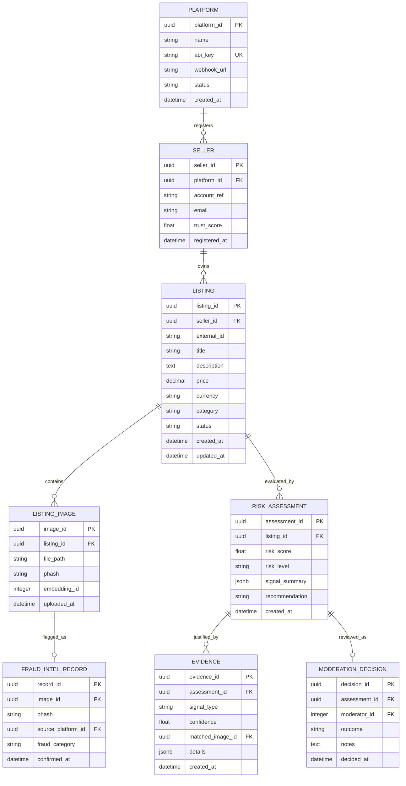

# Database Schema & Entity-Relationship Specification

This document details the complete relational data models, fields, types, constraints, and relationships for the **Image Similarity** fraud detection system.

---

## 1. Entity-Relationship Diagram (ERD)

---

## 2. Table Specifications

### 2.1 Table: `platforms`
Client stores and marketplaces authorized to connect with the fraud screening service.

| Column | Type | Constraints | Description |
|---|---|---|---|
| `platform_id` | UUID | Primary Key | Unique platform identifier. |
| `name` | VARCHAR(150) | Not Null | Display name (e.g. "Mombasa Tech Hub"). |
| `api_key` | VARCHAR(64) | Unique, Indexed | Hashed secret key for API requests. |
| `webhook_url` | VARCHAR(500) | Nullable | Asynchronous callback URL. |
| `status` | VARCHAR(20) | Default: `'ACTIVE'` | `'ACTIVE'`, `'SUSPENDED'`, `'INACTIVE'`. |
| `created_at` | TIMESTAMPTZ | Default: `now()` | Registration timestamp. |

---

### 2.2 Table: `sellers`
Seller accounts operating within participating platforms.

| Column | Type | Constraints | Description |
|---|---|---|---|
| `seller_id` | UUID | Primary Key | Internal UUID identifier. |
| `platform_id` | UUID | Foreign Key (`platforms`) | Associated platform. |
| `account_ref` | VARCHAR(120) | Composite Unique | Store-specific merchant ID. |
| `email` | VARCHAR(255) | Nullable | Merchant contact email. |
| `trust_score` | FLOAT | Default: `1.0` (0.0 to 1.0) | Historical reliability index. |
| `registered_at` | TIMESTAMPTZ | Default: `now()` | Platform onboarding timestamp. |

---

### 2.3 Table: `listings`
Product listings screened for fraudulent content.

| Column | Type | Constraints | Description |
|---|---|---|---|
| `listing_id` | UUID | Primary Key | Unique listing record identifier. |
| `seller_id` | UUID | Foreign Key (`sellers`) | Merchant offering the item. |
| `external_id` | VARCHAR(120) | Indexed | Source store product ID. |
| `title` | VARCHAR(255) | Not Null | Product advertisement title. |
| `description` | TEXT | Nullable | Full product description copy. |
| `price` | DECIMAL(12,2) | Not Null | Unit price offered. |
| `currency` | VARCHAR(10) | Default: `'KES'` | ISO currency code. |
| `category` | VARCHAR(100) | Indexed | Product classification. |
| `status` | VARCHAR(20) | Default: `'PENDING'` | `'PENDING'`, `'APPROVED'`, `'FLAGGED'`, `'REJECTED'`. |
| `created_at` | TIMESTAMPTZ | Default: `now()` | Submission timestamp. |
| `updated_at` | TIMESTAMPTZ | Default: `now()` | Last modification timestamp. |

---

### 2.4 Table: `listing_images`
Product imagery indexed with perceptual hashes and vector embeddings.

| Column | Type | Constraints | Description |
|---|---|---|---|
| `image_id` | UUID | Primary Key | Unique image UUID. |
| `listing_id` | UUID | Foreign Key (`listings`) | Associated listing record. |
| `image_file` | VARCHAR(500) | Nullable | Local disk or object storage path. |
| `file_path` | VARCHAR(500) | Nullable | External URL if hotlinked. |
| `phash` | VARCHAR(64) | Indexed | 64-bit hexadecimal pHash fingerprint. |
| `dhash` | VARCHAR(64) | Indexed | 64-bit difference hash. |
| `embedding_id` | INTEGER | Indexed | Vector index row pointer in FAISS. |
| `uploaded_at` | TIMESTAMPTZ | Default: `now()` | Image ingest timestamp. |

---

### 2.5 Table: `risk_assessments`
Composite multi-signal fraud evaluations.

| Column | Type | Constraints | Description |
|---|---|---|---|
| `assessment_id` | UUID | Primary Key | Unique evaluation UUID. |
| `listing_id` | UUID | Foreign Key (`listings`) | Target listing screened. |
| `risk_score` | FLOAT | Range $0.0 - 100.0$ | Aggregate composite risk rating. |
| `risk_level` | VARCHAR(10) | Indexed | `'LOW'`, `'MEDIUM'`, `'HIGH'`. |
| `signal_summary` | JSONB | Default: `{}` | Breakdown of individual module outputs. |
| `recommendation` | VARCHAR(30) | Not Null | `'APPROVE'`, `'MANUAL_REVIEW'`, `'AUTO_HOLD'`. |
| `created_at` | TIMESTAMPTZ | Default: `now()` | Evaluation completion timestamp. |

---

### 2.6 Table: `evidence`
Individual diagnostic signals justifying an assessment.

| Column | Type | Constraints | Description |
|---|---|---|---|
| `evidence_id` | UUID | Primary Key | Unique evidence item identifier. |
| `assessment_id` | UUID | Foreign Key (`risk_assessments`) | Parent assessment. |
| `signal_type` | VARCHAR(50) | Indexed | e.g. `'VECTOR_SIMILARITY'`, `'TEXT_MISMATCH'`. |
| `confidence` | FLOAT | Range $0.0 - 1.0$ | Signal severity / confidence rating. |
| `matched_image_id`| UUID | Foreign Key (`listing_images`) | Matched duplicate image if applicable. |
| `details` | JSONB | Default: `{}` | Diagnostic metadata (e.g. cosine distance, ELA ratio). |
| `created_at` | TIMESTAMPTZ | Default: `now()` | Logging timestamp. |

---

### 2.7 Table: `moderation_decisions`
Audit trail of human moderator reviews.

| Column | Type | Constraints | Description |
|---|---|---|---|
| `decision_id` | UUID | Primary Key | Unique decision UUID. |
| `assessment_id` | UUID | One-to-One (`risk_assessments`) | Assessed case under review. |
| `moderator_id` | INTEGER | Foreign Key (`auth_user`) | Reviewing human moderator. |
| `outcome` | VARCHAR(30) | Not Null | `'CONFIRMED_FRAUD'`, `'DISMISSED_LEGITIMATE'`, `'ESCALATED'`. |
| `notes` | TEXT | Nullable | Moderator rationale notes. |
| `decided_at` | TIMESTAMPTZ | Default: `now()` | Final verdict timestamp. |

---

### 2.8 Table: `fraud_intel_records`
Cross-platform shared repository of confirmed fraud fingerprints.

| Column | Type | Constraints | Description |
|---|---|---|---|
| `record_id` | UUID | Primary Key | Unique intelligence record ID. |
| `image_id` | UUID | Foreign Key (`listing_images`) | Source image if stored in Nexora. |
| `phash` | VARCHAR(64) | Indexed | Perceptual hash of confirmed fraudulent image. |
| `source_platform_id`| UUID | Foreign Key (`platforms`) | Platform that reported the confirmed fraud. |
| `fraud_category` | VARCHAR(50) | Default: `'STOLEN_PHOTO'` | `'STOLEN_PHOTO'`, `'COUNTERFEIT'`, `'SCAM'`. |
| `notes` | VARCHAR(255) | Nullable | Brief non-PII case summary. |
| `confirmed_at` | TIMESTAMPTZ | Default: `now()` | Confirmation timestamp. |
