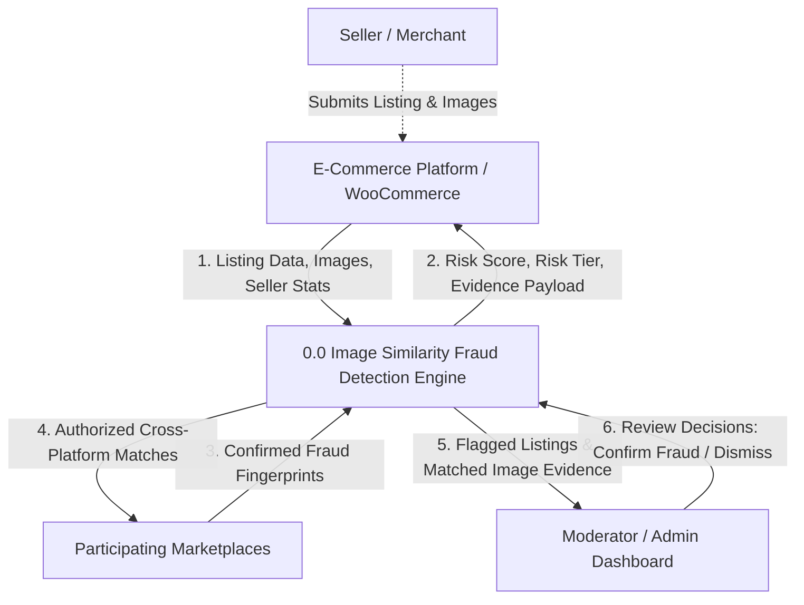
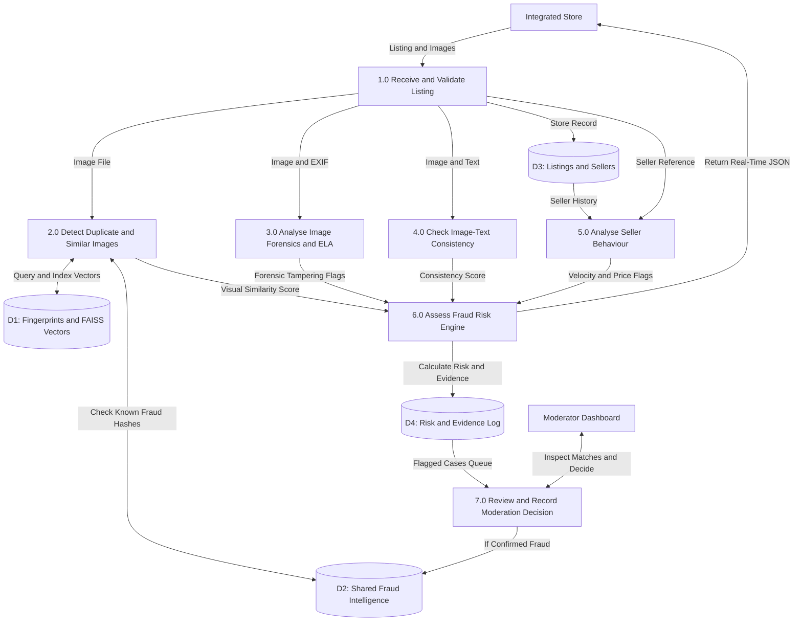

# System Data Flow Diagrams (DFD)

This document provides the formal structural and behavioral process models for the **Image Similarity** fraud detection system, decomposing listing reception, multi-signal analysis, risk assessment, and moderation workflows.

---

## 1. Context Diagram (Level 0 DFD)

The Context Diagram defines the system boundary and captures data exchanges between the core engine and all external entities.

### External Entities Description
| Entity | Interaction & Responsibilities |
|---|---|
| **Seller / Merchant** | Interacts indirectly with the system through the client e-commerce platform by submitting product listings, imagery, and pricing. |
| **E-Commerce Platform (Client Store)** | Transmits new/updated listing payloads (images, text, price, seller reference) to the API and receives real-time risk scores and status recommendations. |
| **Participating Marketplaces** | Contribute confirmed fraudulent image hashes to the shared repository and receive cross-platform similarity alerts. |
| **Moderator / Admin** | Reviews flagged listings through the dedicated dashboard, inspects side-by-side evidence, and submits audit-logged verdicts. |

---

## 2. Level 1 Logical Data Flow Diagram (DFD)

The Level 1 DFD decomposes the system into seven core functional processes and four primary data stores.

---

## 3. Process Specifications (Mini-Specs)

### Process 1.0: Receive & Validate Listing
* **Input Data:** Multipart form-data containing product title, description, price, category, seller reference, and uploaded image files.
* **Processing Logic:** Validates required fields, checks image file integrity (MIME type, resolution $\ge 224 \times 224$), enforces platform API key authentication, and creates persistent database records in `D3`.
* **Output Data:** Validated listing entity and preprocessed image stream.

### Process 2.0: Detect Duplicate & Similar Images
* **Input Data:** Preprocessed image array.
* **Processing Logic:** 
  1. Computes 64-bit perceptual hash (pHash) and difference hash (dHash).
  2. Queries `D2` (Shared Fraud Intelligence) for known blacklisted hashes (Hamming distance $\le 5$).
  3. Extracts 512-dimensional deep embedding via PyTorch ResNet/CLIP.
  4. Queries `D1` (FAISS Vector Index) for nearest neighbor cosine similarity ($k=5$).
* **Output Data:** Visual similarity score ($0.0 - 1.0$), matched image references, and duplication flags.

### Process 3.0: Analyse Image Forensics & ELA
* **Input Data:** Raw image binary and EXIF headers.
* **Processing Logic:** Parses metadata tags for image editing software traces (Photoshop, Canva, GIMP). Re-saves image at standard JPEG quality ($Q=90$) to calculate pixel error matrices (Error Level Analysis) and detects compression anomalies.
* **Output Data:** Forensic tampering score ($0.0 - 1.0$) and anomaly tags.

### Process 4.0: Check Image-Text Consistency
* **Input Data:** Preprocessed image and listing text (title + description).
* **Processing Logic:** Encodes image and text into a shared multimodal latent space using CLIP. Computes cosine alignment score.
* **Output Data:** Semantic consistency score ($0.0 - 1.0$) and mismatch warning flag.

### Process 5.0: Analyse Seller Behaviour
* **Input Data:** Seller account reference and listing category.
* **Processing Logic:** Queries `D3` for historical listing frequency in the past 1h/24h. Calculates category price distribution $Z$-score and checks for cross-account image reuse.
* **Output Data:** Behavioral anomaly confidence score ($0.0 - 1.0$) and velocity flags.

### Process 6.0: Assess Fraud Risk Engine
* **Input Data:** Signals from Processes 2.0, 3.0, 4.0, and 5.0.
* **Processing Logic:** Calculates weighted composite risk score ($0.0 - 100.0$), determines risk tier (`LOW`, `MEDIUM`, `HIGH`), formats human-readable evidence records, and logs evaluation into `D4`.
* **Output Data:** Structured JSON risk evaluation payload returned to calling store.

### Process 7.0: Review & Record Moderation Decision
* **Input Data:** Moderator verdict (`CONFIRMED_FRAUD`, `DISMISSED_LEGITIMATE`, `ESCALATED`) and audit notes.
* **Processing Logic:** Records verdict in `D4`. If confirmed fraudulent, automatically writes the image hash and categorization into `D2` (Shared Fraud Intelligence).
* **Output Data:** Updated assessment status and new shared intelligence record.

---

## 4. Data Stores Catalog

| Store ID | Name | Storage Mechanism | Contents |
|---|---|---|---|
| **D1** | Fingerprint & Vector Store | Disk (`faiss_index.bin`) & PostgreSQL | 64-bit pHash fingerprints and 512-dim FAISS vector embeddings for all active platform images. |
| **D2** | Shared Fraud Intelligence | PostgreSQL (`fraud_intel_records`) | Cross-platform repository of confirmed fraudulent image hashes, fraud categories, and timestamp. Zero customer PII. |
| **D3** | Listings & Sellers | PostgreSQL (`listings`, `sellers`, `platforms`) | Marketplace accounts, product titles, descriptions, pricing, categories, and image paths. |
| **D4** | Risk & Evidence Log | PostgreSQL (`risk_assessments`, `evidence`, `moderation_decisions`) | Composite risk scores, signal breakdowns, matched evidence items, and human review audit trail. |
